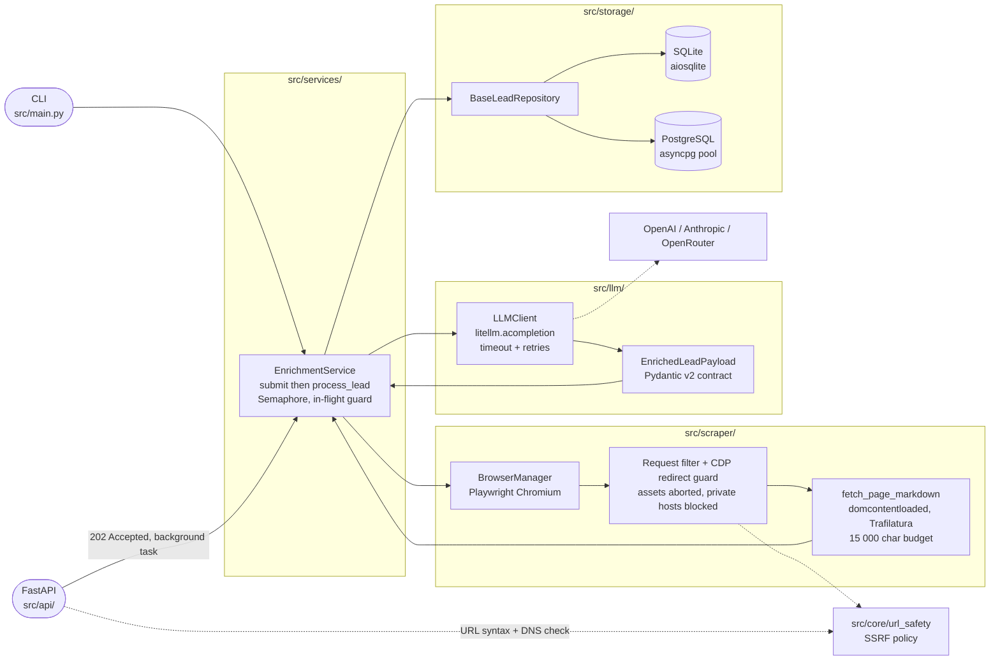

# B2B Lead Enrichment & Scoring Agent

[](https://github.com/Nazar-Plokhuta/lead-enrichment-agent/releases)
[](https://github.com/Nazar-Plokhuta/lead-enrichment-agent/actions)
[](https://www.python.org/)
[](https://fastapi.tiangolo.com/)
[](https://docs.pydantic.dev/)
[](https://docs.astral.sh/uv/)

A high-performance, fully asynchronous pipeline that crawls target company domains, extracts semantic Markdown, and computes deterministic ICP fit scores using LLM structured outputs.  Run it as a **CLI** or as a **REST API** (FastAPI, `202 Accepted` + polling).  The LLM layer is provider-agnostic through [LiteLLM](https://github.com/BerriAI/litellm) (OpenAI, Anthropic, OpenRouter), results are persisted to **SQLite or PostgreSQL**, and the browser is guarded against SSRF, including redirect hops.


**Version 2.0.0** · 147 offline tests · `ruff check` and `ruff format --check` clean

---

## Architecture



**Data flow**:

```
CLI args / POST /api/v1/enrich
  └──► URL safety checks            (syntax, DNS; 422 if unsafe)
        └──► submit                  (idempotency check, PENDING row)         ─► 202 + lead_id
              └──► asyncio.Semaphore (concurrency gate)
                    └──► Playwright Chromium  (headless, asset-blocked, SSRF-guarded)
                          └──► Trafilatura     (HTML → clean Markdown)
                                └──► LiteLLM   (Markdown → EnrichedLeadPayload, schema-constrained)
                                      └──► SQLite or PostgreSQL  (PROCESSED, or FAILED + safe reason)
GET /api/v1/leads/{lead_id}  ◄── client polls until PROCESSED or FAILED
```

The full design, with sequence and state diagrams, is in [`docs/internal/architecture.md`](docs/internal/architecture.md); module-by-module state and the decision log (D-01 … D-12) are in [`docs/internal/state.md`](docs/internal/state.md).

---

## Key Technical Features

### Fully Asynchronous I/O

Every network and database operation runs on the asyncio event loop with no blocking calls.  Playwright's `async_api`, `litellm.acompletion`, `aiosqlite` / `asyncpg`, and FastAPI are used throughout.  `asyncio.gather` fans out CLI URL tasks in parallel, and the API hands work to background tasks; both are bounded by one shared `asyncio.Semaphore` so browser processes and provider rate limits are never exhausted.

### Provider-Agnostic, Strict Schema Validation, Zero Raw JSON Parsing

The extraction contract is a Pydantic v2 model hierarchy (`EnrichedLeadPayload`) passed to LiteLLM as `response_format`.  The reply is parsed exactly once, with `EnrichedLeadPayload.model_validate_json`.  There are no calls to `json.loads()` anywhere in the codebase, and a schema mismatch becomes a typed `LLMExtractionError` instead of an unvalidated dict flowing into storage.  Switching provider is a one-line `LLM_MODEL` change; the provider and API key are resolved from an explicit allowlist (`openai`, `anthropic`, `openrouter`), so a model from an unsupported vendor is rejected at startup rather than sent the wrong key.

### Resilient Resource Management

| Mechanism | Implementation |
|---|---|
| Asset blocking | Context-level Playwright route interception aborts `image`, `media`, `font`, and `stylesheet` requests before they are fetched. |
| Anti-hang timeout | `domcontentloaded` wait strategy with a hard `PAGE_TIMEOUT_MS` ceiling; never waits for analytics beacons or SSE streams to close. |
| Bounded LLM waits | `LLM_TIMEOUT_S` (45 s) per attempt and `LLM_MAX_RETRIES` (2): a call holds a concurrency slot for at most 135 s with the defaults. |
| Zombie prevention | `BrowserManager` closes the browser, then stops the Playwright driver, in independent `try/finally` blocks; a failed launch or a cancellation still stops the driver. |
| Error isolation | Domain exceptions (`ScrapeError`, `LLMExtractionError`) insulate the service from Playwright and provider internals, and carry a caller-safe `public_reason`. |

### Concurrency & Idempotency Control

`asyncio.Semaphore(MAX_CONCURRENT_SCRAPES)` bounds live browser contexts and simultaneous LLM requests.  The idempotency check (`submit`) runs *before* semaphore acquisition so already-processed URLs consume no slot.  Insert-if-absent on the `url` UNIQUE constraint (`INSERT OR IGNORE` on SQLite, `ON CONFLICT DO NOTHING RETURNING` on PostgreSQL) removes the TOCTOU race between concurrent submissions.  Re-submitting a `FAILED` URL, or a `PROCESSED` one with `force`, resets it to `PENDING` first so pollers never read the previous run's outcome, and an in-flight guard stops a repeated request from starting a second pipeline for the same lead.

### Security Model

The service points a real browser at caller-supplied URLs, so it defends where the browser may connect and what failures reveal:

- **Front door**: URL syntax is validated without I/O (scheme, backslash and whitespace tricks, blocked names such as `localhost` and `*.internal`, private IP literals), then the hostname is resolved and *every* address must be public (this also catches `2130706433`-style obfuscation).
- **Every browser request**: each navigation and sub-resource request is vetted against the same policy and aborted if the destination is non-public.
- **Redirects**: a CDP `Fetch` interceptor at the response stage reads the `Location` of every 3xx and fails the request before Chromium follows it, closing the "public URL that 302s to `169.254.169.254`" hole that route interception alone cannot see.
- **Fail closed**: a failed lookup, a crashing guard, or an error in the redirect handler denies the request.
- **Sanitised errors**: only a fixed `public_reason` is stored on the lead and returned by the API.  Raw Playwright, provider and driver text (internal hostnames, key fragments, DSNs) goes to logs only.
- **Secrets**: API keys and `DATABASE_URL` are `SecretStr`; provider and HTTP loggers are pinned to `WARNING` so `LOG_LEVEL=DEBUG` never dumps request headers.

See [Known Limits](#known-limits) for what this does *not* cover.

---

## Project Structure

```
lead-enrichment-agent/
├── src/
│   ├── config.py              # Settings (pydantic-settings), get_repository()
│   ├── main.py                # Async CLI (argument parsing, Rich output)
│   ├── api/
│   │   ├── app.py             # create_app() factory, lifespan, API_VERSION
│   │   ├── routes.py          # /api/v1/enrich, /api/v1/leads, /health
│   │   ├── schemas.py         # Request and response DTOs
│   │   └── security.py        # API-facing re-export of core.url_safety
│   ├── services/
│   │   └── enrichment.py      # EnrichmentService: submit / process_lead (CLI + API)
│   ├── core/
│   │   ├── exceptions.py      # Exception hierarchy, reason / public_reason split
│   │   ├── url_safety.py      # SSRF primitives shared by API and scraper
│   │   └── log_config.py      # Logging bootstrap for the API process
│   ├── scraper/
│   │   ├── browser.py         # Chromium lifecycle, request filter, CDP redirect guard
│   │   ├── fetcher.py         # Navigation, wait strategy, error mapping
│   │   └── cleaner.py         # HTML → Markdown via trafilatura
│   ├── llm/
│   │   ├── schemas.py         # Pydantic v2 DTOs (structured-output contract)
│   │   ├── prompts.py         # Versioned ICP rubric & prompt templates
│   │   └── client.py          # LiteLLM wrapper: provider/key resolution, retries
│   └── storage/
│       ├── base.py            # BaseLeadRepository (ABC)
│       ├── database.py        # SQLite schema DDL and connection manager
│       ├── repository.py      # SQLite driver
│       └── postgres.py        # PostgreSQL driver (asyncpg pool)
├── tests/                     # 147 offline tests (see Testing & Verification)
│   ├── fixtures/eval/         # Golden Markdown pages for offline rubric regression
│   ├── conftest.py            # Autouse guard: no sockets, no DNS
│   └── test_*.py              # api, browser, llm_client, scoring_regression, ...
├── automation/n8n/            # Importable n8n workflow that drives the API
├── docs/internal/
│   ├── architecture.md        # System design, contracts, security topology
│   └── state.md               # Implementation state & decision log (D-01 … D-12)
├── .github/workflows/ci.yml   # uv sync, ruff check, pytest
├── Dockerfile                 # Multi-stage uv build, non-root runtime
├── docker-compose.yml         # app + PostgreSQL + n8n
├── pyproject.toml             # Dependencies and uv settings
├── uv.lock                    # Locked dependency set
├── .env.example               # Environment variable reference
└── pytest.ini                 # Pytest discovery (`pythonpath`, `testpaths`)
```

---

## Setup & Quickstart

### Prerequisites

- **Python 3.11+**
- **[uv](https://docs.astral.sh/uv/)** for the virtual environment and dependencies
- An API key for one supported LLM provider
- **Docker** (optional, for the Compose stack)

### 1. Clone and install

```bash
git clone https://github.com/Nazar-Plokhuta/lead-enrichment-agent.git
cd lead-enrichment-agent
uv sync
uv run playwright install chromium
```

`uv sync` installs the locked runtime and dev dependencies into `.venv`.  Chromium is installed separately because it is a browser binary, not a Python package.

### 2. Configure the environment

```bash
cp .env.example .env
```

Set `LLM_MODEL` and the one API key that matches it (see the table below), then optionally the storage and tuning variables.

#### Configuration reference

| Variable | Default | Description |
|---|---|---|
| `LLM_MODEL` | `gpt-4o-mini` | Model identifier; its prefix selects the provider (see below). |
| `OPENAI_API_KEY` | – | Required for `gpt-*`, `o1`/`o3`/`o4` and `openai/<model>`. |
| `ANTHROPIC_API_KEY` | – | Required for `claude-*` and `anthropic/<model>`. |
| `OPENROUTER_API_KEY` | – | Required for `openrouter/<vendor>/<model>`. |
| `OPENAI_BASE_URL` | – | OpenAI-compatible endpoint override.  OpenAI models only; ignored with a warning for other providers. |
| `LLM_TIMEOUT_S` | `45` | Per-attempt provider timeout, in seconds. |
| `LLM_MAX_RETRIES` | `2` | Retries on transient provider errors (0 to 5). |
| `DATABASE_URL` | – | PostgreSQL DSN (`postgresql://user:pw@host:5432/db`).  When set it replaces SQLite. |
| `DATABASE_PATH` | `leads.db` | SQLite file, used when `DATABASE_URL` is unset. |
| `MAX_CONCURRENT_SCRAPES` | `3` | Semaphore bound for concurrent pipelines. |
| `PAGE_TIMEOUT_MS` | `20000` | Playwright navigation timeout. |
| `LOG_LEVEL` | `INFO` | Application logging level. |

**Supported `LLM_MODEL` values**:

| Provider | Examples | Key |
|---|---|---|
| OpenAI | `gpt-4o-mini`, `openai/gpt-4o` | `OPENAI_API_KEY` |
| Anthropic | `claude-3-5-sonnet-latest`, `anthropic/claude-3-5-sonnet-latest` | `ANTHROPIC_API_KEY` |
| OpenRouter | `openrouter/anthropic/claude-3.5-sonnet` | `OPENROUTER_API_KEY` |

Any other prefix (`gemini/`, `azure/`, ...) is rejected at startup, and a missing key for the selected provider fails fast with a clear message.

> **Upgrading from v1.x**: `OPENAI_MODEL` was renamed to `LLM_MODEL`.  An old `.env` that still sets `OPENAI_MODEL` is silently ignored and the default model is used, so rename it.  `requirements.txt` is gone; use `uv sync`.

### 3. Run it

**CLI**: enrich one or more URLs and print a results table:

```bash
uv run python -m src.main https://linear.app https://vercel.com

# Re-enrich URLs that were already processed
uv run python -m src.main https://linear.app --force
```

| Argument | Description |
|---|---|
| `URL [URL ...]` | One or more fully-qualified company URLs to enrich. |
| `--force` | Re-enrich URLs already in `PROCESSED` state; without it they are skipped. |

The CLI renders Rich output: coloured, structured logs on stderr, and on completion a run summary panel (submitted / enriched / failed / skipped) plus a per-URL table of company, score, tier and status on stdout, so results can be piped.

**REST API**: serve it with uvicorn:

```bash
uv run uvicorn src.api.app:app --host 127.0.0.1 --port 8000
```

Interactive docs are at <http://127.0.0.1:8000/docs> and the OpenAPI document at `/openapi.json`.

**Docker Compose**: API, PostgreSQL and n8n together (see [Docker Compose & n8n](#docker-compose--n8n)):

```bash
docker compose up -d --build
```

### 4. Query results

```bash
# SQLite
sqlite3 leads.db "SELECT url, company_name, fit_score, fit_tier, status FROM leads ORDER BY fit_score DESC;"

# PostgreSQL (Compose stack)
docker compose exec postgres psql -U postgres -d leads_db \
  -c "SELECT url, company_name, fit_score, fit_tier, status FROM leads ORDER BY fit_score DESC NULLS LAST;"
```

---

## REST API

Enrichment is asynchronous: `POST` returns as soon as the lead exists, and the client polls for the outcome.

| Method and path | Success | Errors |
|---|---|---|
| `POST /api/v1/enrich` | `202` queued, or `200` if the URL is already `PROCESSED` and `force` is false | `422` unsafe, malformed or unresolvable URL |
| `GET /api/v1/leads/{lead_id}` | `200` lead with its `status` and `enriched_data` | `404` unknown id |
| `GET /api/v1/leads` | `200` paginated list, newest first.  Query: `page` (≥ 1), `page_size` (1 to 100, default 50), `fit_tier`, `status` | `422` invalid query |
| `GET /health` | `200` `{"status":"healthy","database":"ok"}` | `503` when the database is unreachable |

**Submit a URL**:

```bash
curl -s -X POST http://127.0.0.1:8000/api/v1/enrich \
  -H 'Content-Type: application/json' \
  -d '{"url": "https://linear.app", "force": false}'
```

```json
{"lead_id": 1, "url": "https://linear.app", "status": "PENDING", "message": "Enrichment queued."}
```

**Poll until `status` is `PROCESSED` or `FAILED`**:

```bash
curl -s http://127.0.0.1:8000/api/v1/leads/1
```

```json
{
  "id": 1,
  "url": "https://linear.app",
  "status": "PROCESSED",
  "company_name": "Linear",
  "fit_score": 85,
  "fit_tier": "Tier 1 (High)",
  "enriched_data": { "company_name": "Linear", "analysis": {}, "scoring": {}, "outreach": {} },
  "error_message": null,
  "created_at": "2026-10-14T09:12:41",
  "updated_at": "2026-10-14T09:13:02"
}
```

(`enriched_data` holds the full payload shown under [Example Output](#example-output); it is abbreviated here.)

**List the best leads**:

```bash
curl -s --get http://127.0.0.1:8000/api/v1/leads \
  --data-urlencode 'fit_tier=Tier 1 (High)' \
  --data-urlencode 'status=PROCESSED' \
  --data-urlencode 'page_size=20'
```

Status values are `PENDING`, `PROCESSED` and `FAILED`.  A `FAILED` lead carries a fixed, sanitised `error_message` such as `Page could not be loaded`, `URL blocked: destination is not a public address`, or `LLM provider request failed (RateLimitError)`; the full detail is in the server logs.  Re-submitting a `FAILED` URL, or a `PROCESSED` one with `"force": true`, resets it to `PENDING` and queues a new run.

---

## Docker Compose & n8n

```bash
cp .env.example .env      # Compose reads LLM_MODEL and the provider keys from here
docker compose up -d --build
```

| Service | Address (host) | Notes |
|---|---|---|
| `app` | `127.0.0.1:8000` | FastAPI + Playwright, non-root user, `init: true`, `shm_size: 1gb`, healthcheck on `/health`. |
| `postgres` | `127.0.0.1:5432` | `postgres:16-alpine`, data in the `postgres_data` volume; `app` starts only once it is healthy. |
| `n8n` | `127.0.0.1:5678` | Self-hosted automation; starts after `app` is healthy and reaches it as `http://app:8000`. |

The image is a multi-stage `uv` build: dependencies come from `uv.lock` (`uv sync --frozen`), and Chromium is installed from that same locked Playwright package so the browser revision always matches.  The `app` service is wired to PostgreSQL through `DATABASE_URL`.

[`automation/n8n/`](automation/n8n/README.md) contains an importable workflow: a webhook receives a company URL, calls `POST /api/v1/enrich`, polls `GET /api/v1/leads/{lead_id}`, and routes the result by ICP fit.

---

## Known Limits

These are deliberate, documented boundaries of v2.0, not hidden behaviour:

- **No built-in authentication.**  The API is unauthenticated.  The Compose stack binds every published port to `127.0.0.1`, and any wider exposure assumes an upstream API gateway or reverse proxy that provides access control and TLS.
- **In-process background tasks.**  Jobs run as FastAPI background tasks inside the API process.  If the process restarts mid-job, that lead stays `PENDING`; nothing sweeps stale rows, and re-submitting the URL re-queues it.  The in-flight guard and semaphore are per-process, so run a single API worker.  A durable queue is the intended next step if the API moves beyond one instance.
- **SSRF boundaries.**  Chromium re-resolves a hostname when it connects, so DNS rebinding between our lookup and the browser's is not closed, and popups and cross-site iframes run in targets without the redirect interceptor.  The guard is defence in depth; egress filtering on the scraper host remains the backstop.
- **Retry-only LLM routing.**  `LLM_MAX_RETRIES` retries transient errors on the one configured model.  There is no fallback model or provider, so a sustained provider outage marks leads `FAILED` (safe to re-submit).
- **PostgreSQL driver is tested through Compose, not offline.**  The offline suite forbids sockets, so the Postgres driver has no unit tests, and schema management is `CREATE ... IF NOT EXISTS` with no migration tool.
- **Unpinned base images.**  The `uv` and `n8n` images use `latest`; Python dependencies are pinned by `uv.lock`.

---

## Testing & Verification

Everything runs through `uv`:

```bash
uv run pytest                      # 147 tests, offline
uv run ruff check src/             # lint
uv run ruff format --check src/    # formatting
```

`pytest.ini` sets `pythonpath = .` and `testpaths = tests`, so a bare run collects the suite and imports `src` without an editable install.  CI (`.github/workflows/ci.yml`) runs `uv sync --dev`, `uv run ruff check src/` and `uv run pytest tests/ -v`, exporting a mock `OPENAI_API_KEY` that the suite never uses to reach a provider.

**The suite is strictly offline.**  An autouse fixture in `tests/conftest.py` makes `socket.create_connection`, `socket.socket.connect` and `socket.getaddrinfo` raise, so any test that opens a connection or resolves a name fails.  The API tests inject a fake LLM client, a fake scraper and a fake host resolver, so a green run needs no provider key, no Chromium and no network, and spends no tokens.

**Current verification status**: 147 tests passing; `ruff check src/` and `ruff format --check src/` are both clean.

| File | Tests | What it locks |
|---|---|---|
| `test_api.py` | 42 | Endpoint status codes (200, 202, 404, 422, 503), idempotent and `force` submission, failures recorded without driver or vendor detail, pagination and filters, URL-safety helpers. |
| `test_browser.py` | 39 | Request filter and fail-closed destination policy, CDP redirect guard, guard attachment on every page, teardown under launch failure, body exceptions and cancellation, sanitised navigation errors. |
| `test_llm_client.py` | 38 | Provider and key resolution, rejection of unsupported models, retry and timeout forwarding, base-URL scoping, generic public errors, empty and malformed responses, logger pinning. |
| `test_scoring_regression.py` | 19 | Golden fixtures, inclusive band edges, out-of-contract bodies, schema and prompt-band invariants. |
| `test_logging.py` | 4 | Log-level application and fail-fast on an unknown level. |
| `test_enrichment_service.py` | 3 | `submit` and `reset_to_pending` semantics. |
| `test_schemas.py` | 2 | DTO smoke checks. |
| **Total** | **147** | |

**Deterministic offline regression.**  `tests/test_scoring_regression.py` validates ICP rubric scoring and the structured-output contract on local data.  Golden Markdown pages in `tests/fixtures/eval/` stand in for Trafilatura output, each paired with an expected `EnrichedLeadPayload` label.  The suite checks:

- Schema acceptance through `EnrichedLeadPayload.model_validate` (the contract the production path enforces with `model_validate_json`), plus a JSON round-trip (`model_dump_json` → `model_validate_json`).
- Tier consistency against the v2.0 inclusive bands (Tier 1: 75–100, Tier 2: 50–74, Tier 3: 25–49, Disqualified: 0–24), including the eight boundary scores 0, 24, 25, 49, 50, 74, 75 and 100.
- Rubric arithmetic.  `scoring_rationale` must contain exactly one `A=…, B=…, C=…, D=… → total=…` line.  Sub-scores stay inside the dimension ceilings (35 / 25 / 20 / 20), sum to `fit_score`, and fall in the business-model band for that archetype.  A Disqualified label awards 0 on dimension A.
- Evidence grounding.  Company name, pain points, evidence anchors, and the detail cited by `icebreaker` must appear in the fixture page.
- Negative schema assertions.  `fit_score` below 0, `fit_score` above 100, and tier labels outside the `Literal` (`Tier 4 (Ultra)`, `high`) raise `ValidationError` with the expected Pydantic error type.
- Prompt drift.  The tier bands are parsed out of `SYSTEM_PROMPT_TEMPLATE` and must equal the in-suite oracle.

**Not covered offline**: the PostgreSQL driver, a real Chromium launch, and live provider calls.  The live `linear.app` enrichment remains the end-to-end behavioural check.

---

## Example Output

Verified enrichment result for **[linear.app](https://linear.app)**, a B2B SaaS product-development tool (the `enriched_data` payload):

```json
{
  "company_name": "Linear",
  "analysis": {
    "industry": "B2B SaaS – Product Development Tools",
    "target_audience": "Modern product teams (10–500 employees)",
    "value_proposition": "Linear is a purpose-built product development system designed for modern teams, integrating AI workflows to streamline planning and building products.",
    "pain_points": [
      "Streamlining product planning and building processes",
      "Aligning teams with product initiatives and strategic roadmaps",
      "Automating issue routing and prioritization based on customer feedback"
    ]
  },
  "scoring": {
    "fit_tier": "Tier 1 (High)",
    "fit_score": 85,
    "scoring_rationale": "Linear operates as a B2B SaaS company focused on product development tools, which aligns with our ICP. The page indicates a dedicated focus on modern teams and AI workflows, suggesting a tech-enabled service model. The absence of employee count is noted, but the product's focus on teams implies a likely fit within the 10–500 employee range. The presence of features like automations and integrations indicates a strong product-led growth pattern. There are no disqualifying factors present, and the value proposition is clearly articulated.",
    "missing_information": [
      "Employee count not mentioned"
    ]
  },
  "outreach": {
    "icebreaker": "I noticed that Linear is designed for modern teams with AI workflows at its core, which is a game-changer for product development.",
    "suggested_angle": "Given Linear's focus on streamlining product planning and building processes, our solution could enhance your existing workflows by providing additional automation and integration capabilities that further optimize team collaboration."
  }
}
```

**Score breakdown**: 85/100 → Tier 1 (High).  The recorded rationale notes the missing employee-count signal and confirms the remaining ICP evidence from the page (B2B SaaS, product-led growth patterns, integrations/API, named growth-stage customers).  This JSON is a live enrichment snapshot.  Band edges, tier–score consistency, and the required sub-score line are locked by the offline suite under [Testing & Verification](#testing--verification).

---

## ICP Scoring Rubric

| Score Range | Tier | Interpretation |
|---|---|---|
| 75 – 100 | Tier 1 (High) | Strong ICP fit; prioritise for immediate outreach. |
| 50 – 74 | Tier 2 (Medium) | Partial fit; engage with qualification questions. |
| 25 – 49 | Tier 3 (Low) | Weak fit; defer or monitor. |
| 0 – 24 | Disqualified | Does not meet ICP criteria (B2C, NGO, sole trader, enterprise, etc.). |

Scoring follows the v2.0 additive rubric.  `scoring_rationale` is written first as a chain-of-thought scratchpad and must close with one sub-score line (`A=…, B=…, C=…, D=… → total=…`).  `fit_score` is that total.  The four ceilings are business model (35), target market (25), commercial clarity (20), and technical proof (20).  `fit_tier` is derived from the total using the bands above.  Gaps are recorded in `missing_information` and reduce only the dimension they affect (employee count → B, pricing → C).

---

## Technology Stack

| Layer | Library | Version |
|---|---|---|
| Async runtime | `asyncio` (stdlib) | Python 3.11+ |
| Web scraping | `playwright` | ≥ 1.44.0 |
| HTML normalisation | `trafilatura` | ≥ 2.0.0 |
| LLM gateway | `litellm` | ≥ 1.105.0 |
| LLM exception types | `openai` | ≥ 1.30.0 (exception hierarchy only) |
| REST API | `fastapi` + `uvicorn[standard]` | ≥ 0.143.0 / ≥ 0.54.0 |
| Schema validation | `pydantic` | ≥ 2.7.0 |
| Settings | `pydantic-settings` | ≥ 2.3.0 |
| Persistence (default) | `aiosqlite` | ≥ 0.20.0 |
| Persistence (server) | `asyncpg` (PostgreSQL 16 in Compose) | ≥ 0.32.0 |
| CLI & Formatting | `rich` | ≥ 13.7.0 |
| Tooling | `uv`, `ruff` ≥ 0.4.0, `pytest` ≥ 8.0.0, `pytest-asyncio` ≥ 0.23.0, `httpx` ≥ 0.28.1 (tests) | locked in `uv.lock` |
