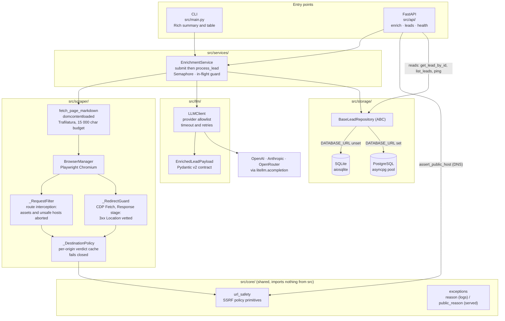
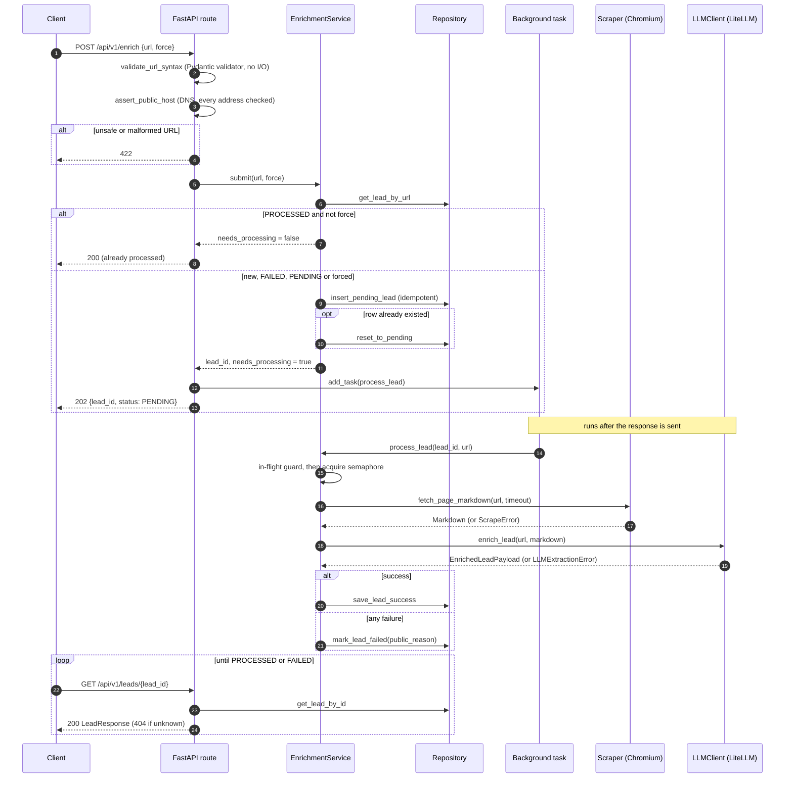
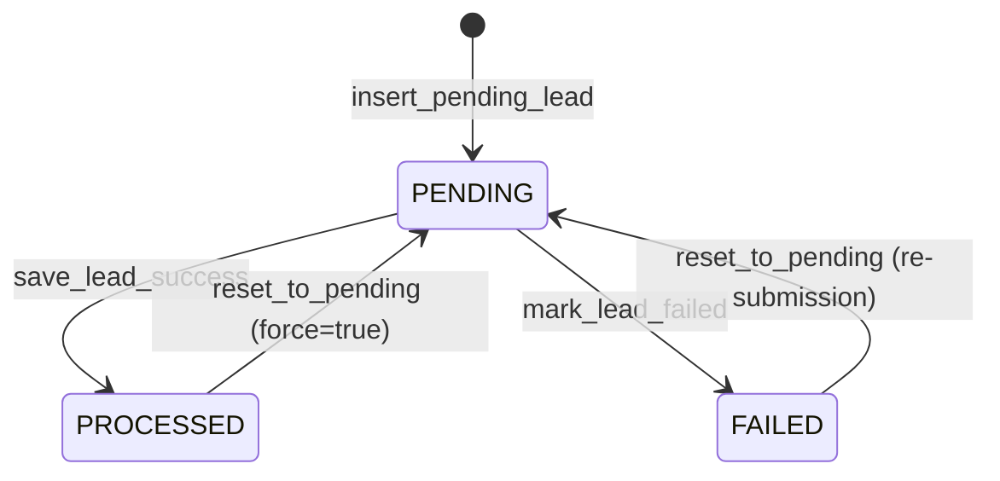
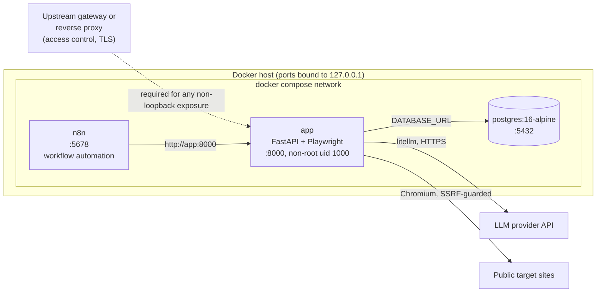

# Architecture Specification: B2B Lead Enrichment & Scoring Agent

> **Version**: 2.0.0.  Companion document: [`state.md`](state.md) records the
> implementation state of each module and the decision log (D-01 … D-12);
> this document specifies the shape of the system and the rules it must keep.

## 1. High-Level Architecture

The system turns a company URL into a validated, scored lead record.  Two
entry points (a CLI and a REST API) share one service, which drives a
guarded browser, a provider-agnostic LLM client and a swappable repository.



**Pipeline** (one lead):

1. **Input**: a company URL, from the CLI arguments or `POST /api/v1/enrich`.
2. **Submit** (`EnrichmentService.submit`): idempotency check, `PENDING` row
   creation, and `reset_to_pending` for a re-run.  Runs before the semaphore.
3. **Scrape** (`src/scraper/`): headless Chromium navigates with
   `wait_until="domcontentloaded"`; image, media, font and stylesheet requests
   are aborted; every request and every redirect hop is vetted against the SSRF
   policy.
4. **Normalise** (`src/scraper/cleaner.py`): Trafilatura strips navigation,
   cookie banners and footers and returns Markdown, truncated on a word
   boundary to 15,000 characters (about 3,750 tokens).
5. **Extract and score** (`src/llm/`): `litellm.acompletion` with
   `response_format=EnrichedLeadPayload`; the reply is parsed once with
   `EnrichedLeadPayload.model_validate_json`.
6. **Persist** (`src/storage/`): `save_lead_success` stores the validated
   payload (`PROCESSED`), or `mark_lead_failed` stores a sanitised reason
   (`FAILED`).

## 2. Asynchronous Request Flow

`POST /api/v1/enrich` returns as soon as the lead row exists; the work runs in
a background task and the client polls.



**Lead status machine** (`leads.status`):



The CLI takes the same path with the HTTP layer removed: `enrich_url` awaits
`submit` and then `process_lead` directly, and `asyncio.gather` fans out over
all URLs.  A restart while a lead is `PENDING` strands it until the URL is
submitted again (see D-12 and §9 in `state.md`).

---

## 3. Directory Layout & Module Responsibilities

- `src/config.py`: `Settings` (pydantic-settings, secrets as `SecretStr`), the cached `get_settings()`, and `get_repository()`, which picks the storage backend from `DATABASE_URL`.
- `src/core/`:
  - `exceptions.py`: `LeadEnrichmentError` hierarchy; every error carries `reason` (logs) and `public_reason` (stored and served).
  - `url_safety.py`: SSRF primitives shared by the API and the scraper.
  - `log_config.py`: `configure_logging(level)` for the API process.
- `src/scraper/`:
  - `browser.py`: Playwright lifecycle, `_RequestFilter`, `_DestinationPolicy`, `_RedirectGuard` (CDP).
  - `fetcher.py`: navigation, `domcontentloaded` wait, anti-hang timeout, error mapping to `ScrapeError`.
  - `cleaner.py`: raw HTML to normalised, budgeted Markdown.
- `src/llm/`:
  - `schemas.py`: Pydantic models for the extraction contract.
  - `prompts.py`: versioned ICP rubric (v2.0) and prompt builders.
  - `client.py`: `LLMClient`, a LiteLLM wrapper with provider and key resolution, retries and error mapping.
- `src/storage/`:
  - `base.py`: `BaseLeadRepository` ABC.
  - `database.py`, `repository.py`: SQLite schema and driver (`aiosqlite`).
  - `postgres.py`: PostgreSQL driver (`asyncpg` pool).
- `src/services/enrichment.py`: `EnrichmentService` (`submit`, `process_lead`, `enrich_url`), shared by both entry points.
- `src/api/`:
  - `app.py`: `create_app()` factory, lifespan, `API_VERSION`.
  - `routes.py`: the four endpoints.
  - `schemas.py`: request and response DTOs.
  - `security.py`: re-export of `src.core.url_safety` for the API layer.
- `src/main.py`: CLI entry point (argument parsing and Rich presentation only).
- `tests/`: 147 offline tests (§10): `conftest.py`, `test_api.py`, `test_browser.py`, `test_llm_client.py`, `test_scoring_regression.py`, `test_logging.py`, `test_enrichment_service.py`, `test_schemas.py`, and `fixtures/eval/` golden pages.
- `pytest.ini`: `pythonpath = .` and `testpaths = tests`, so the suite imports `src` without an editable install.
- `pyproject.toml` and `uv.lock`: dependency manifest and lockfile; `Dockerfile` and `docker-compose.yml`: container build and stack; `automation/n8n/`: importable workflow that drives the API.

---

## 4. Data Contracts (Pydantic DTOs)

### 4.1 Extraction contract (`src/llm/schemas.py`)

```python
from typing import Literal
from pydantic import BaseModel, Field

class CompanyAnalysis(BaseModel):
    industry: str = Field(description="Primary vertical or industry")
    target_audience: str = Field(description="Target persona (SMB, Mid-Market, Enterprise)")
    value_proposition: str = Field(description="Core value offering in 1-2 clear sentences")
    pain_points: list[str] = Field(description="Top 3 customer problems found on the page")

class LeadScoring(BaseModel):
    fit_tier: Literal["Tier 1 (High)", "Tier 2 (Medium)", "Tier 3 (Low)", "Disqualified"]
    fit_score: int = Field(ge=0, le=100, description="Deterministic ICP match score (0-100)")
    scoring_rationale: str = Field(description="Fact-based chain-of-thought ending in one A/B/C/D arithmetic line")
    missing_information: list[str] = Field(default_factory=list, description="Information missing to score accurately")

class OutreachStrategy(BaseModel):
    icebreaker: str = Field(description="1-2 highly personalized lines referencing verified facts on the site")
    suggested_angle: str = Field(description="Recommended positioning angle for sales outreach")

class EnrichedLeadPayload(BaseModel):
    company_name: str
    analysis: CompanyAnalysis
    scoring: LeadScoring
    outreach: OutreachStrategy
```

`missing_information` defaults to an empty list and is omitted from `LeadScoring`'s JSON-schema `required` array. `fit_tier` serialises as an enum of the four literals above. `fit_score` serialises as an integer with `minimum` 0 and `maximum` 100. Nested `$defs` are exactly `CompanyAnalysis`, `LeadScoring`, and `OutreachStrategy`. `EnrichedLeadPayload.model_json_schema()` is the document sent to the provider as `response_format`, and the offline suite in §10 treats it as this contract.

### 4.2 API contract (`src/api/schemas.py`)

| Model | Fields |
|---|---|
| `EnrichRequest` | `url: str` (validated by `validate_url_syntax`; kept a plain `str`, not `HttpUrl`, so the stored identity key matches the CLI's), `force: bool = False` |
| `EnrichResponse` | `lead_id: int`, `url: str`, `status: str`, `message: str` |
| `LeadResponse` | `id`, `url`, `status: LeadStatus`, `company_name`, `fit_score`, `fit_tier`, `enriched_data: dict \| None` (stored JSON text parsed by a `TypeAdapter`), `error_message`, `created_at`, `updated_at`; never `raw_markdown` |
| `LeadListResponse` | `items: list[LeadResponse]`, `total`, `page`, `page_size` |
| `HealthResponse` | `status: str`, `database: str` |

`LeadStatus = Literal["PENDING", "PROCESSED", "FAILED"]` and `FitTier` repeats the four tier literals.  FastAPI generates the OpenAPI document (`/openapi.json`) and the interactive docs (`/docs`) from these models.

---

## 5. API Contract

| Method and path | Success | Error responses |
|---|---|---|
| `POST /api/v1/enrich` | `202` `EnrichResponse` (queued) or `200` (already `PROCESSED`, `force` false) | `422` unsafe, malformed or unresolvable URL, or invalid body |
| `GET /api/v1/leads/{lead_id}` | `200` `LeadResponse` | `404` unknown id |
| `GET /api/v1/leads` | `200` `LeadListResponse`; query `page` (>= 1, default 1), `page_size` (1..100, default 50), `fit_tier`, `status` | `422` invalid query |
| `GET /health` | `200` `{"status": "healthy", "database": "ok"}` | `503` `{"status": "unhealthy", "database": "unreachable"}` |

Rules:

- `POST /enrich` never blocks on scraping or the LLM.  The returned `lead_id` is the polling handle.
- Re-submitting a `PROCESSED` URL without `force` is a no-op answered with `200`; with `force` (or for a `FAILED` lead) the status is reset to `PENDING` and the work is queued again.
- Lists are newest first (`ORDER BY id DESC`); `total` is the filtered count ignoring paging.
- `error_message` on a `FAILED` lead is always a fixed, sanitised category (§7), never raw driver or provider text.
- The API has no authentication.  It is intended to sit behind a gateway or reverse proxy; the Compose stack binds it to loopback.

Lifecycle: the application factory `create_app(settings, *, llm_client, scraper)` builds the repository in the lifespan, awaits `init_db()` before serving, and awaits `close()` on shutdown.  Injecting `llm_client` and `scraper` lets tests run the full request path with fakes.

---

## 6. Storage Schema

`BaseLeadRepository` is the only storage surface the service, CLI and API use; each driver owns its SQL.  The backend is selected by `get_repository()`: PostgreSQL when `DATABASE_URL` is set (it must start with `postgresql://` or `postgres://`, otherwise `ValueError`), SQLite on `DATABASE_PATH` otherwise.

### 6.1 SQLite (`leads` table)

```
CREATE TABLE IF NOT EXISTS leads (
    id INTEGER PRIMARY KEY AUTOINCREMENT,
    url TEXT NOT NULL UNIQUE,
    domain TEXT NOT NULL,
    company_name TEXT,
    fit_score INTEGER,
    fit_tier TEXT,
    enriched_data JSON,
    raw_markdown TEXT,
    status TEXT CHECK(status IN ('PENDING', 'PROCESSED', 'FAILED')) DEFAULT 'PENDING',
    error_message TEXT,
    created_at TIMESTAMP DEFAULT CURRENT_TIMESTAMP,
    updated_at TIMESTAMP DEFAULT CURRENT_TIMESTAMP
);

CREATE INDEX IF NOT EXISTS idx_leads_domain ON leads(domain);
CREATE INDEX IF NOT EXISTS idx_leads_fit_score ON leads(fit_score);
```

One connection is opened per repository call (D-04); inserts use `INSERT OR IGNORE` followed by `SELECT id` (D-03).

### 6.2 PostgreSQL (`leads` table)

```
CREATE TABLE IF NOT EXISTS leads (
    id              BIGINT GENERATED ALWAYS AS IDENTITY PRIMARY KEY,
    url             TEXT        NOT NULL UNIQUE,
    domain          TEXT        NOT NULL,
    company_name    TEXT,
    fit_score       INTEGER,
    fit_tier        TEXT,
    enriched_data   JSONB,
    raw_markdown    TEXT,
    status          TEXT        NOT NULL DEFAULT 'PENDING'
                                CHECK (status IN ('PENDING', 'PROCESSED', 'FAILED')),
    error_message   TEXT,
    created_at      TIMESTAMPTZ NOT NULL DEFAULT now(),
    updated_at      TIMESTAMPTZ NOT NULL DEFAULT now()
);

CREATE INDEX IF NOT EXISTS idx_leads_domain    ON leads(domain);
CREATE INDEX IF NOT EXISTS idx_leads_fit_score ON leads(fit_score);
```

Access goes through one `asyncpg.Pool` (1 to 10 connections) created in `init_db()` and closed in `close()`.  Inserts use `ON CONFLICT (url) DO NOTHING RETURNING id` with a `SELECT id` fallback (D-03, D-08).  Both drivers exclude `raw_markdown` from API-facing reads.  Schema management is `CREATE ... IF NOT EXISTS` only; there is no migration tool.

---

## 7. Security Architecture

The service drives a real browser at caller-supplied URLs and returns stored failure text to callers, so it defends two things: **where the browser may connect** (SSRF) and **what failures reveal** (information leakage).

### 7.1 SSRF defence in depth

| Layer | Where | What it stops |
|---|---|---|
| 1. Syntax | `EnrichRequest` validator, `validate_url_syntax` (no I/O) | Non-http(s) schemes, empty or over-2048-character URLs, whitespace, control characters and backslashes (`http://127.0.0.1\@example.com`), malformed ports, `localhost` and `*.local`, `*.internal`, `*.localhost`, `*.localdomain`, `*.home.arpa`, private or reserved IP literals |
| 2. Resolution | Route, `assert_public_host` | Hostnames resolving to any non-public address, including obfuscated forms (`2130706433`, `0x7f.1`); every resolved address is checked; a failed lookup is a rejection |
| 3. Per-request | `_RequestFilter` via Playwright `route` | Navigation and sub-resource requests to non-public destinations; aborted (`blockedbyclient`), never fulfilled |
| 4. Redirects | `_RedirectGuard`, CDP `Fetch` at the `Response` stage | A public URL that answers `302` to `169.254.169.254` or another private target; the request is failed before Chromium follows it |
| 5. Output | `public_reason` (§7.2) | Using error text to map the internal network |
| 6. Deployment | Compose and Dockerfile (§9) | LAN exposure of the unauthenticated API; root in the browser container |

Layers 3 and 4 share one `_DestinationPolicy` (a cache of per-`scheme://host:port` verdicts around `assert_public_destination`), so same-origin traffic costs one lookup.  The policy **fails closed**: a failed lookup or a crashing guard denies the request, and the redirect handler fails the paused request on any internal error, because an unanswered paused request would hang the navigation.  `data:`, `blob:` and `about:` URLs bypass the policy (no host).  `_is_public_ip` is `is_global and not is_multicast`, and it unwraps IPv4-mapped IPv6.

**Residual limits.**  Chromium resolves a name again when it connects, so DNS rebinding between our lookup and the browser's is not closed.  Popups and cross-site iframes run in targets that do not carry the redirect interceptor.  This design is defence in depth; egress filtering on the scraper host remains the backstop.

### 7.2 Error sanitisation

Every `LeadEnrichmentError` has two strings: `reason`, the full diagnostic, goes to logs only; `public_reason`, a fixed caller-safe summary, is the only text written to `leads.error_message` and returned by the API.

| Failure | Stored and served `error_message` |
|---|---|
| Navigation timeout | `Navigation timed out after <N>ms` |
| Request blocked by policy | `URL blocked: destination is not a public address` |
| Other navigation error | `Page could not be loaded` |
| DOM read failed after navigation | `Page content could not be read` |
| LLM provider error | `LLM provider request failed (<ExceptionType>)` |
| LLM empty response | `LLM returned an empty response` |
| LLM schema mismatch | `LLM response did not match the expected schema` |
| Any other exception | `Unexpected error: <ExceptionType>` |

Playwright messages name the exact internal address; provider errors can echo endpoints and key fragments; arbitrary exception text can carry DSNs and paths.  None of that reaches the database or an HTTP response.  Secrets are `SecretStr` (`*_API_KEY`, `DATABASE_URL`), and LiteLLM, `httpx`, `httpcore` and `openai` loggers are pinned to `WARNING`, so `LOG_LEVEL=DEBUG` does not dump provider traffic.

### 7.3 Credential scoping

The provider is resolved from `LLM_MODEL` against an allowlist (`openai`, `anthropic`, `openrouter`) and only the matching key is sent.  An unsupported prefix is rejected at construction rather than defaulted to OpenAI.  `OPENAI_BASE_URL` applies to OpenAI models only, so a proxy URL can never receive another vendor's key.

---

## 8. Architectural Invariants (Non-Negotiable)

These are the rules in `CLAUDE.md`, with the v2.0 additions marked.

1. **AsyncIO first.**  All network, browser and database I/O uses `async`/`await`.  No `time.sleep`, `requests` or `urllib.request` in the application (`urllib.parse` is pure string handling; the container healthcheck's `urllib.request` call runs outside the app).
2. **Decoupled modules.**  The scraper never imports storage or LLM modules.  The LLM module never touches the database and never makes network calls to scraped sites.  *v2.0:* `src/core/` is a leaf that imports nothing from `src`, which is why the SSRF primitives live there and the API re-exports them.
3. **Strict schema contracts, zero raw JSON parsing.**  Data between the LLM and storage passes through `EnrichedLeadPayload`; LLM output is parsed only with `model_validate_json`, never `json.loads`.  *v2.0:* stored JSON text is parsed for API responses by a Pydantic `TypeAdapter`, not by hand.
4. **Defensive scraping (D-01).**  Always `wait_until="domcontentloaded"`, with image, media, font and stylesheet requests aborted by route interception.  Never `networkidle`.
5. **Idempotency and bounded concurrency (D-03).**  `asyncio.Semaphore` bounds concurrency; inserts are insert-if-absent plus read-back (`INSERT OR IGNORE` + `SELECT id`, or `ON CONFLICT DO NOTHING RETURNING` + `SELECT id`).
6. **No silent failures.**  No bare `except:` and no `except Exception: pass`.  Every caught exception is logged with structure (`logger.error`, `logger.warning` or `logger.exception`) before it is converted, swallowed or re-raised.
7. **Public/private error split** *(v2.0, D-10).*  Anything persisted or returned to a caller is a `public_reason`; `reason` and tracebacks stay in logs.
8. **Fail-closed SSRF policy** *(v2.0, D-09).*  Every browser request, redirect hops included, passes `assert_public_destination`; an error in the guard denies the request, and unsafe requests are aborted, never fulfilled.
9. **One service, two transports** *(v2.0, D-12).*  Pipeline semantics (idempotency, reset, failure recording) live in `EnrichmentService`; entry points add no pipeline logic.  `process_lead` never raises for pipeline failures.
10. **One repository contract** *(v2.0, D-08).*  The service, CLI and API depend on `BaseLeadRepository` only; a new contract method is implemented in both drivers.
11. **Offline tests.**  The suite makes no network connection and no DNS lookup (`tests/conftest.py`).  Never add real network or provider calls to `tests/`.

---

## 9. Deployment Topology



- **Image** (`Dockerfile`): multi-stage.  The builder runs `uv sync --frozen --no-dev` against copied manifests; the runtime stage copies the venv, runs `playwright install --with-deps chromium` from that venv (so the browser revision matches the locked Playwright package), copies `src/`, and drops to a non-root user (uid 1000).  `CMD` is `uv run uvicorn src.api.app:app --host 0.0.0.0 --port 8000`; `UV_FROZEN` and `UV_NO_SYNC` keep `uv run` from re-resolving at start.
- **Compose** (`docker-compose.yml`): `postgres` with a `pg_isready` healthcheck; `app` waits for it (`service_healthy`) and sets `DATABASE_URL`, `LLM_MODEL`, the three provider keys, `LLM_TIMEOUT_S` and `LLM_MAX_RETRIES`; `n8n` waits for the `app` healthcheck.  `init: true` reaps zombie Chromium processes, and `shm_size: 1gb` avoids Chromium crashes on the 64 MB default.
- **Health**: `GET /health` returns `503` when the database is unreachable, which fails the container healthcheck.
- **Exposure**: all three published ports bind to `127.0.0.1`.  The API is unauthenticated, so any wider exposure requires an upstream gateway or reverse proxy that provides access control and TLS.
- **Not pinned**: the `uv` image and `n8n` image use `latest`; the Python dependencies are pinned by `uv.lock`.
- **CI** (`.github/workflows/ci.yml`): `uv sync --dev`, `uv run playwright install chromium`, `uv run ruff check src/`, `uv run pytest tests/ -v` with a mock `OPENAI_API_KEY`, `LLM_MODEL=gpt-4o-mini` and `DATABASE_PATH=:memory:`.

---

## 10. Evaluation & Regression Testing Architecture

The regression suite locks the same Pydantic contract and the same published tier bands the live LLM path uses, on fixtures that live in the repository, so a schema or rubric edit fails CI before any token is spent.  It is one part of the 147-test offline suite; the other files are listed in §10.4.

### 10.1 Golden Dataset Strategy

`tests/fixtures/eval/` holds hand-authored Markdown pages. They occupy the same role as Trafilatura output: substantive page text, already free of navigation chrome, passed to the rubric as the sole evidence source. Each file is registered as a `ScoringEvalCase` in `tests/test_scoring_regression.py`. `to_payload()` builds a plain dictionary and runs it through `EnrichedLeadPayload.model_validate`. That is the same Pydantic contract the production path enforces (`EnrichedLeadPayload.model_validate_json` on the provider's reply), exercised on a local dict so the suite stays offline. A directory test requires the `*.md` names on disk and the registered fixture names to be the same set. An unregistered page, or a registered name whose file is gone, fails the suite.

| Fixture | Company | Archetype | Score | Tier | Dimension A band |
|---|---|---|---|---|---|
| `tier1_saas.md` | Forgeboard | Per-seat B2B SaaS, public plans, named customers, SOC 2 | 92 | Tier 1 (High) | 30–35 (awarded 33) |
| `tier2_consulting.md` | Harborline Partners | Tech-enabled consulting, demo-only commercial path | 54 | Tier 2 (Medium) | 15–25 (awarded 22) |
| `disqualified_b2c.md` | Willow & Grain | Consumer furniture catalog, no software product | 11 | Disqualified | 0 (incompatible model) |

The test asserts grounding on the case itself. It requires `company_name`, every `pain_points` entry, every evidence anchor, and the icebreaker's cited detail (`Helio Payments`, `discovery workshop`, `Sunday Sofa`) to occur in the page text, and the cited detail to occur in `icebreaker`. A JSON round-trip (`model_dump_json` then `model_validate_json`) must reproduce the payload, which checks that the DTO stays serialisable in the shape `enriched_data` stores.

Sub-scores are parsed from a single arithmetic line inside `scoring_rationale`. That line must match `A=<int>, B=<int>, C=<int>, D=<int> → total=<int>`, and it must appear exactly once. Those four integers must equal the case's `dimension_scores`, respect the ceilings 35 / 25 / 20 / 20, and sum to both the stated total and `fit_score`. Dimension A must also sit inside the archetype band in the table. A Disqualified case must award 0 on A, matching the prompt rule that an incompatible business model zeroes that dimension and forces the tier.

### 10.2 Rubric Boundary Enforcement

Bands are inclusive and taken from the v2.0 `FIT TIER MAPPING` block in `SYSTEM_PROMPT_TEMPLATE`. `tier_for_score` is the in-suite oracle. `test_offline_bands_match_published_prompt` parses the same four lines out of the prompt (en dash, `U+2013`) and requires the two maps to be equal. Editing a boundary in the prompt without updating the oracle fails CI.

| Tier | Inclusive band |
|---|---|
| Tier 1 (High) | 75–100 |
| Tier 2 (Medium) | 50–74 |
| Tier 3 (Low) | 25–49 |
| Disqualified | 0–24 |

The edges themselves are schema-valid `LeadScoring` values, parametrised as eight cases: 100 and 75 (Tier 1), 74 and 50 (Tier 2), 49 and 25 (Tier 3), 24 and 0 (Disqualified). A separate test walks every integer from 0 through 100 and requires the four bands to be disjoint and exhaustive. Tier 3 has edge coverage and partition coverage. The golden pages in §10.1 cover Tier 1, Tier 2, and Disqualified, which are the three archetype outcomes the current fixture set labels.

Negative schema assertions construct a `LeadScoring` body that must raise `pydantic.ValidationError`, and they match `loc` plus `type` on the error list:

| Case | Input | Expected error |
|---|---|---|
| `score-below-zero` | `fit_score=-1` | `loc=("fit_score",)`, `type="greater_than_equal"` |
| `score-above-100` | `fit_score=101` | `loc=("fit_score",)`, `type="less_than_equal"` |
| `unknown-tier` | `fit_tier="Tier 4 (Ultra)"` | `loc=("fit_tier",)`, `type="literal_error"` |
| `lowercase-tier` | `fit_tier="high"` | `loc=("fit_tier",)`, `type="literal_error"` |

`test_schemas.py` repeats the upper-bound rejection (`fit_score=150`) via the model constructor, and builds one fully populated `EnrichedLeadPayload` (company, `CompanyAnalysis`, `LeadScoring`, `OutreachStrategy`) as a smoke check that the object graph still assembles.

`test_lead_scoring_schema_matches_dto_contract` reads `EnrichedLeadPayload.model_json_schema()` and locks the document sent to the provider as `response_format`:

- Top-level `required`: `company_name`, `analysis`, `scoring`, `outreach`.
- `$defs` keys: `CompanyAnalysis`, `LeadScoring`, `OutreachStrategy`.
- `LeadScoring.fit_tier.enum` equals the four tier literals, in oracle order.
- `LeadScoring.fit_score` is an integer with `minimum` 0 and `maximum` 100.
- `LeadScoring.required` is `fit_tier`, `fit_score`, `scoring_rationale`. `missing_information` stays optional because the field has a default.
- `CompanyAnalysis.required`: `industry`, `target_audience`, `value_proposition`, `pain_points`.
- `OutreachStrategy.required`: `icebreaker`, `suggested_angle`.

### 10.3 Offline Determinism Guarantees

Every test in the suite runs under an autouse fixture in `tests/conftest.py` that replaces `socket.create_connection`, `socket.socket.connect` and `socket.getaddrinfo` with a function that raises `AssertionError`, so a TCP connection or a DNS lookup fails the run.  `test_scoring_regression.py` keeps its own `create_connection` guard as well. A future edit that reaches the network during collection or execution fails the suite. Golden labels are dictionaries validated by Pydantic. The module imports `SYSTEM_PROMPT_TEMPLATE` and the four DTOs (`EnrichedLeadPayload`, `CompanyAnalysis`, `LeadScoring`, `OutreachStrategy`). `LLMClient` construction, provider-key reads, and `litellm.acompletion` calls sit outside this module.

That split is deliberate. Live enrichment remains variable in free-text fields because `LLMClient` uses temperature `0.1`, and it depends on provider availability. The regression job's result is a pure function of the fixture files, the prompt text, and the DTO definitions. CI can therefore sync dependencies with `uv sync --dev`, run `uv run pytest` with a mock API key, and treat a failure as a contract diff: a moved band, a renamed field, a `Literal` change, a fixture whose evidence is missing from the page, or sub-scores that disagree with `fit_score`. Provider latency and token spend stay on the manual enrichment path.
### 10.4 The rest of the offline suite

The scoring regression above is 19 of the 147 tests.  The remainder lock the v2.0 behaviour; every one runs under the same socket guard and uses injected fakes (LLM client, scraper, host resolver) instead of a provider, a browser or DNS.

| File | Tests | Locks |
|---|---|---|
| `test_api.py` | 42 | Endpoint status codes (200, 202, 404, 422, 503), the idempotent and `force` paths, failure recording without driver or vendor detail, list pagination and filters, URL-safety helpers |
| `test_browser.py` | 39 | Request filter, destination policy and its fail-closed behaviour, CDP redirect guard, `new_page` guard attachment, teardown under failure and cancellation, sanitised navigation errors |
| `test_llm_client.py` | 38 | Provider and key resolution, allowlist rejection, retry and timeout forwarding, base-URL scoping, generic public errors, schema-mismatch and empty-response handling, logger pinning |
| `test_scoring_regression.py` | 19 | Sections 10.1 to 10.3 |
| `test_logging.py` | 4 | `configure_logging` behaviour |
| `test_enrichment_service.py` | 3 | `submit` and `reset_to_pending` semantics |
| `test_schemas.py` | 2 | DTO smoke checks |
| **Total** | **147** | |

Not covered offline: `PostgresLeadRepository` (the suite forbids sockets; verified through the Compose stack), a real Chromium launch, and live provider calls.  `ruff check src/` and `ruff format --check src/` are both clean; CI runs the lint check and the suite.
